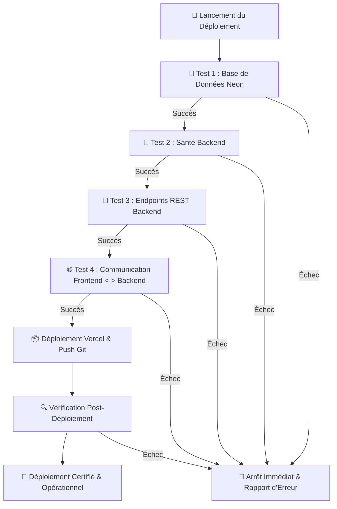

# 🚀 Workflow Opérationnel : Déploiement & Tests de Connectivité

Ce workflow spécifie la séquence automatisée d'exécution des tests de connectivité (Neon DB, Backend, Endpoints API, Communication Frontend-Backend) et de déploiement continu.

---

## 1. Secrets & Environnement (`link_repo.txt`)

Le workflow s'appuie sur les identifiants déclarés :
- `VERCEL_TOKEN` : Déploiement et gestion des projets Vercel Frontend et Backend.
- `NEON_API_URL` & `NEON_PROJECT_ID` : Supervision et interaction avec la base de données PostgreSQL serverless Neon.
- `GITHUB_PERSONAL_ACCESS_TOKEN` : Synchronisation des dépôts distants (push sur la branche `main`).

---

## 2. Protocole Obligatoire des 4 Tests de Connectivité

À chaque cycle de déploiement (pré et post-mise en ligne), le script de vérification exécute la suite complète :



### 2.1 Test 1 : Connectivité Neon DB
- Test de socket TCP et négociation SSL vers l'hôte Neon.
- Appel REST probe vers l'API de monitoring Neon (`NEON_API_URL`).
- Exécution d'une requête probe SQL `SELECT 1;` via `AsyncSession` / `psycopg2` / `asyncpg`.
- **Validation** : Réponse SQL reçue sans erreur en moins de 1500ms.

### 2.2 Test 2 : Santé Backend
- Requête HTTP `GET` vers l'endpoint probe de santé (`/health` ou `/docs`).
- **Validation** : Code statut HTTP 200, temps de réponse inférieur à 400ms.

### 2.3 Test 3 : Endpoints REST Backend
- Vérification systématique de l'accessibilité de l'ensemble des routes créées :
  - `POST /api/auth/login` (validation du validateur Pydantic sur payload test).
  - `GET /api/users` (validation de la sécurisation par token Bearer).
  - `GET /api/roles` (vérification du catalogue des rôles).
  - `GET /api/teams` (vérification du listing des équipes).
  - `GET /api/participants` (vérification du registre des bloomers).
  - `GET /api/tickets` (vérification de la billetterie).
  - `GET /api/payments` (vérification du module financier).
- **Validation** : Les routes répondent avec les codes attendus (200, 201 ou 401 si authentification requise).

### 2.4 Test 4 : Communication Frontend <-> Backend
- Émission d'une requête preflight CORS (`OPTIONS`) avec en-tête `Origin: https://frontend-cp-app.vercel.app`.
- Validation de la présence de `Access-Control-Allow-Origin` autorisant le domaine frontend.
- Test de propagation du jeton `Authorization: Bearer <token>`.
- Résolution valide de `NEXT_PUBLIC_API_URL`.
- **Validation** : Aucune erreur CORS ou de rupture de communication.

---

## 3. Étapes d'Exécution du Workflow

### Étape 1 : Tests Pré-Déploiement (@devops)
- Exécution du script de connectivité en local / CI :
  ```bash
  python backend/scripts/verify_connectivity.py --env local
  ```

### Étape 2 : Déploiement Cloud (@devops)
- Déploiement sur Vercel avec le jeton d'accès :
  ```bash
  vercel --prod --token $VERCEL_TOKEN
  ```
- Push et synchronisation sur GitHub avec `GITHUB_PERSONAL_ACCESS_TOKEN`.

### Étape 3 : Tests Post-Déploiement (@devops)
- Exécution du script de connectivité sur les URLs de production :
  ```bash
  python backend/scripts/verify_connectivity.py --env production
  ```

### Étape 4 : Rapport de Déploiement (@devops)
- Synthèse des URLs en ligne actives (Frontend, Backend, Swagger UI) et statut des 4 tests de connectivité partagés à l'utilisateur.

