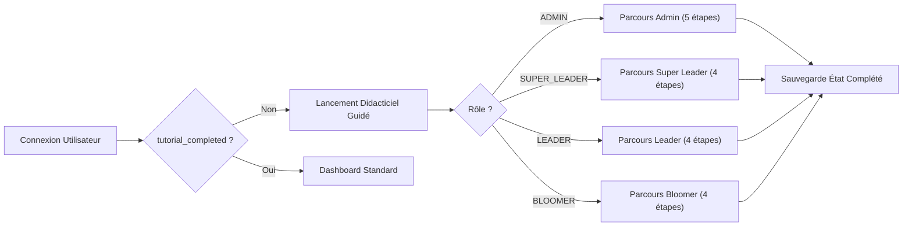

# 🎓 Workflow Fonctionnel : Didacticiel Interactif (Walkthrough)

Ce workflow spécifie la séquence de conception, développement, validation et vérification pour la fonctionnalité du didacticiel interactif et onboarding guidé de la plateforme Christmas Party.

---

## 1. Périmètre Fonctionnel du Didacticiel

Le système de didacticiel guide l'utilisateur pas-à-pas à travers l'interface pour lui présenter les fonctionnalités clés adaptées à son rôle.

### 1.1 Règles de Fonctionnement
- **Déclenchement automatique** : Activé automatiquement à la première connexion d'un utilisateur dont le profil indique `tutorial_completed == false`.
- **Relance manuelle** : Présence d'un déclencheur visuel (bouton "🎓 Didacticiel" ou "Visite guidée") dans l'en-tête et la barre latérale pour rejouer la visite à tout moment.
- **Persistance de l'état** : Sauvegarde locale (`localStorage`) et mise à jour de l'attribut utilisateur en base (`tutorial_completed: true`) lors de la complétion ou de l'abandon explicite ("Passer").
- **Composant UI** :
  - Surbrillance ciblée (backdrop sombre avec zone découpée sur le composant en cours d'explication).
  - Popover festif interactif avec titre de l'étape, contenu explicatif, jauge de progression (*Étape X / Y*), bouton *Précédent*, bouton *Suivant*, et bouton *Passer le didacticiel*.

---

## 2. Parcours Guidés par Profil

1. **Parcours Administrateur** :
   - Étape 1 : Vue d'ensemble du Dashboard (statistiques globales, billetterie, recettes).
   - Étape 2 : Gestion des Utilisateurs et Rôles (affectation des Super Leaders et Leaders).
   - Étape 3 : Module de Billetterie (création des types de billets et suivi des quotas).
   - Étape 4 : Gestion des Paiements (validation financière et réconciliation).
   - Étape 5 : Console de Déploiement & Santé Système.
2. **Parcours Super Leader** :
   - Étape 1 : Tableau de bord transversal des équipes.
   - Étape 2 : Suivi global des inscriptions des Bloomers.
   - Étape 3 : Liste des versements en attente de validation d'équipe.
   - Étape 4 : Statistiques d'atteinte des objectifs.
3. **Parcours Leader** :
   - Étape 1 : Tableau de bord de l'équipe et coordonnées.
   - Étape 2 : Inscription rapide d'un nouveau Bloomer.
   - Étape 3 : Enregistrement d'un versement pour un membre de son équipe.
   - Étape 4 : Suivi des billets de son équipe.
4. **Parcours Bloomer** :
   - Étape 1 : Bienvenue sur votre espace participant Christmas Party !
   - Étape 2 : Consultation et téléchargement de votre Billet numérique avec QR Code.
   - Étape 3 : Suivi de votre solde et état de votre paiement.
   - Étape 4 : Déclaration d'un versement autonome.

---

## 3. Étapes d'Exécution du Workflow

### Étape 1 : Spécification des Étapes (@pm)
- Formalisation des sélecteurs CSS cibles (`data-tutorial-step="step-name"`).
- Rédaction des textes explicatifs chaleureux et festifs pour chaque étape et rôle.

### Étape 2 : Implémentation Frontend (@engineer)
- Création du composant [`InteractiveTutorial.tsx`](file:///d:/Workspace/CHRISTMASPARTY/frontend/src/components/InteractiveTutorial.tsx) avec `framer-motion`.
- Intégration des attributs `data-tutorial-step` sur les composants clés du layout et des pages.
- Ajout de l'endpoint et de la fonction API de mise à jour du statut `tutorial_completed`.

### Étape 3 : Validation & Tests Qualité (@qa)
- **Tests UI** : vérification du positionnement dynamique du popover selon la taille d'écran (responsive).
- **Tests de Navigation** : vérification du bon fonctionnement des boutons Suivant, Précédent, et Passer.
- **Tests de Persistance** : vérification que la visite ne se relance pas intempestivement après rechargement de page une fois complétée.

