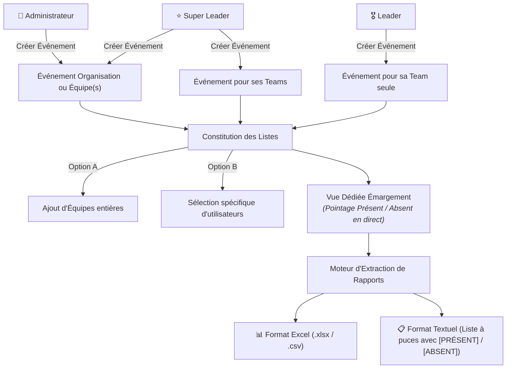

# 📅 Workflow Fonctionnel : Événements, Émargement & Rapports Détaillés

Ce workflow spécifie la séquence de création d'événements selon les rôles, la constitution des listes de participants, la vue dédiée de pointage des présences et le moteur d'extraction de rapports détaillés.

---

## 1. Périmètre Fonctionnel



---

## 2. Règles Métiers Détaillées

### 2.1 Habilitations de Création d'Événements (CRUD)
- **Administrateur** : Peut créer, modifier et supprimer des événements pour toute l'organisation ou pour n'importe quelle équipe ciblée.
- **Super Leader** :
  - Peut créer un événement pour **toute l'organisation**.
  - Peut créer un événement restreint à **ses propres équipes supervisées**.
- **Leader** :
  - Peut créer un événement restreint exclusivement à **sa propre équipe**.
  - Ne peut ni modifier ni voir les événements internes d'autres équipes.

### 2.2 Constitution des Listes de Participants
Lors de la création ou configuration d'un événement, le gestionnaire associe les participants via :
1. **Listes Pré-établies (Équipes)** : Sélection en 1 clic d'une ou plusieurs équipes entières (tous les bloomers et membres rattachés à ces équipes sont automatiquement inscrits à l'événement).
2. **Listes Spécifiques (Sélection d'Utilisateurs)** : Recherche et sélection manuelle d'utilisateurs / bloomers spécifiques pour un événement sur mesure.

### 2.3 Vue Dédiée d'Émargement / Pointage de Présence
- Une interface ergonomique et réactive accessible directement depuis la fiche de l'événement.
- Affiche la liste des membres convoqués avec :
  - Nom, prénom, photo de profil, équipe, téléphone.
  - Commutateur d'état interactif en 1 clic : **[PRÉSENT]** (badge vert) / **[ABSENT]** (badge rouge/gris).
  - Horodatage automatique du pointage et enregistrement de l'auteur du pointage (`checked_by_id`, `checked_at`).
  - Compteur temps réel en en-tête : *Total Convoqués*, *Présents*, *Absents*, *Taux de Présence (%)*.

### 2.4 Moteur d'Extraction de Rapports Détaillés (Multi-Formats & Multi-Filtres)

Le système propose une fonction d'exportation accessible selon les droits :

#### A. Types de Rapports Générés
1. **Rapports de Présence aux Événements** :
   - Fiche d'émargement de l'événement avec état de chaque participant convoqué.
2. **Rapports Financiers & de Paiements** :
   - Liste détaillée des versements, montants encaissés, soldes restants, modes de paiement (Wave, OM, etc.), statut de validation.
3. **Rapports Filtrés par Événements & Dates** :
   - Extraction ciblée sur un événement sélectionné ou sur une période temporelle (plage de dates du ... au ...).

#### B. Formats d'Extraction Disponibles
- **Format Excel (.xlsx / .csv)** :
  - Tableur structuré avec en-têtes de colonnes, filtres automatiques, calculs de sous-totaux.
- **Format Textuel (Liste à puces claire et prête à copier)** :
  - Synthèse compacte idéale pour partage WhatsApp, email ou compte-rendu :
  ```text
  Événement : Répétition Générale Christmas Party
  Date : 12 Décembre 2026 | Lieu : Salle Principale
  Total : 25 | Présents : 20 | Absents : 5 (Taux : 80%)
  
  Liste des Membres :
  • [PRÉSENT] Jean DUPONT - Équipe Alpha (0701020304) - Pointé à 14h05
  • [PRÉSENT] Sara KONE - Équipe Alpha (0506070809) - Pointé à 14h10
  • [ABSENT] Michel COULIBALY - Équipe Alpha (0102030405)
  ```

---

## 3. Étapes d'Exécution du Workflow

### Étape 1 : Conception & Modélisation (@designer & @uiux)
- `@designer` : Ajout des entités `Event` et `EventAttendance` au MCD/MLD, diagramme de cas d'utilisation et séquence d'émargement.
- `@uiux` : Wireframe de la vue d'émargement rapide (mobile-first), boutons d'action rapide Présent/Absent, et modale d'export de rapport (choix du format Excel vs Texte).

### Étape 2 : Implémentation Backend (@engineer)
- Modèles SQLModel : `Event` et `EventAttendance`.
- Endpoints REST :
  - `POST /api/events/` (création selon permissions : Admin, Super Leader, Leader).
  - `POST /api/events/{id}/participants` (rattachement par équipe ou individuel).
  - `GET /api/events/{id}/attendance` & `PUT /api/events/{id}/attendance/{participant_id}` (pointage en 1 clic).
  - `GET /api/events/{id}/export?format=xlsx|csv|txt` (génération dynamique du fichier Excel ou texte).
  - `GET /api/reports/payments?format=xlsx|csv|txt&start_date=...&end_date=...` (rapport financier filtré).

### Étape 3 : Implémentation Frontend (@engineer & @uiux)
- Page Événements (`frontend/src/app/events/page.tsx`).
- Vue Dédiée d'Émargement avec boutons rapides et compteurs temps réel.
- Composant d'exportation avec téléchargement instantané du fichier `.xlsx` ou copie en un clic du rapport textuel dans le presse-papier.

### Étape 4 : Tests & Assurance Qualité (@qa)
- **Tests Unitaires** : Logique de permission de création d'événement, calcul du taux de présence, génération de fichiers Excel/CSV/texte.
- **Tests d'Interfaces (UI)** : Réactivité du commutateur Présent/Absent, téléchargement effectif du fichier Excel, copie du texte.
- **Tests E2E** : Création d'événement par un Super Leader -> Association d'une équipe -> Pointage de présence par le Leader -> Export du rapport textuel et vérification de la mention `[PRÉSENT]` / `[ABSENT]`.
- **Preuves Visuelles** : Captures d'écran via Playwright de la vue d'émargement et du rapport exporté.

