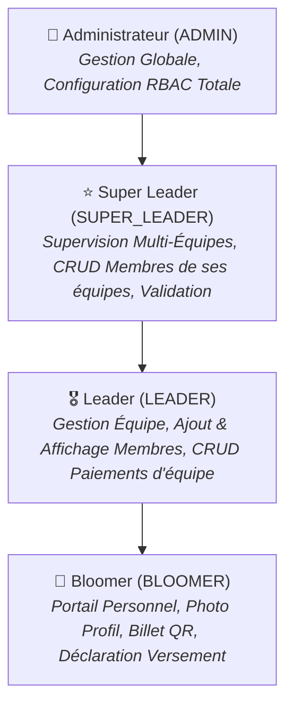

# 👥 Workflow Fonctionnel : Gestion des Rôles & Partitionnement Équipes (RBAC)

Ce workflow spécifie la logique métier, la hiérarchie d'accès, les règles d'étanchéité par équipe, et les interfaces de gestion des rôles et permissions de la plateforme Christmas Party.

---

## 1. Périmètre & Règles Métiers des Rôles

### 1.1 Administrateur (`ADMIN`)
- **Périmètre** : Accès global à toutes les données et entités du système sans restriction d'équipe.
- **Interface de Configuration RBAC (Paramètres)** :
  - **Gestion des Rôles** : Création de nouveaux rôles personnalisés, attribution de libellés et descriptions, sélection des permissions associées depuis le catalogue de permissions.
  - **Attribution des Rôles** : Affectation ou révocation de rôles à tout utilisateur (ex: promouvoir un bloomer en leader ou super leader).
  - **Attribution des Permissions Granulaires** : Donner ou retirer directement des permissions spécifiques à un utilisateur ou à un rôle.
- **Gestion Complète** : Configuration de la billetterie, gestion des quotas, réconciliation financière globale et audit.

### 1.2 Super Leader (`SUPER_LEADER`)
- **Périmètre** : Supervision de son pôle ou de ses équipes rattachées.
- **Droits Membres** :
  - **Peut CRUD les membres de ses équipes** : création, consultation, modification de profil et suppression/désactivation d'un membre/bloomer au sein de son périmètre d'équipe.
- **Droits Financiers** :
  - Consultation consolidée des versements de ses équipes.
  - **Validation officielle** des déclarations de versements soumises par les Leaders ou déclarées en autonomie par les Bloomers.
- **Délégation Hiérarchique de Rôles** :
  - Peut attribuer des rôles ou des permissions **uniquement aux utilisateurs faisant partie de son équipe ou de son périmètre de supervision**.
  - Interdiction absolue d'attribuer des rôles ou d'interagir avec les membres d'autres équipes.
- **Règle d'Isolation Stricte** : Ne peut voir et administrer QUE les informations relatives aux membres de ses équipes supervisées.

### 1.3 Leader (`LEADER`)
- **Périmètre** : Gestion opérationnelle de son équipe unique attribuée.
- **Droits Membres & Restrictions Claires** :
  - **Peut inscrire / ajouter** de nouveaux Bloomers dans son équipe.
  - **Peut afficher et consulter** la liste détaillée des membres de son équipe.
  - **RESTRICTION** : Ne peut **PAS** modifier ni supprimer un membre de l'équipe (ce droit est réservé au Super Leader et à l'Administrateur).
- **Droits Financiers** :
  - **Peut CRUD les paiements** et versements des membres de son équipe (enregistrer un versement reçu, consulter l'historique, ajuster une saisie avant validation).
- **Délégation Hiérarchique de Rôles** :
  - Peut attribuer des rôles subordonnés ou permissions spécifiques **uniquement aux membres de sa propre équipe** (dans la limite des permissions qui lui sont déléguées).
- **Règle d'Isolation Stricte** : Ne peut voir QUE les informations relatives aux membres de sa propre équipe.

### 1.4 Bloomer (`BLOOMER` - Membre / Participant)
- **Périmètre** : Espace membre individuel strictement cloisonné à son propre dossier.
- **Gestion de Profil & Photo** :
  - **Ajout et mise à jour de sa photo de profil** (photo d'identité / avatar) : celle-ci est intégrée à son profil et affichée sur son badge/billet d'entrée officiel.
- **Billet Numérique & Entrée** :
  - Visualisation de son billet avec QR Code unique et téléchargeable pour le contrôle le jour J.
- **Suivi Financier & Solde** :
  - Consultation en temps réel du solde restant dû et de l'historique de ses versements validés.
- **Déclaration Autonome de Versement (Fonctionnement Détaillé)** :
  1. Le Bloomer ouvre le formulaire *"Déclarer un versement"* sur son portail.
  2. Il saisit :
     - Le **montant versé**.
     - Le **mode de paiement** (Wave, Orange Money, Moov Money, Espèces, Virement bancaire).
     - La **référence ou ID de transaction** (reçu de l'opérateur mobile ou numéro de bordereau).
     - La date du versement.
     - **Téléversement de la preuve de versement** (photo du reçu ou capture d'écran du transfert).
  3. La déclaration est enregistrée avec le statut `EN_ATTENTE_VALIDATION`.
  4. Une notification apparaît sur le tableau de bord du Leader et du Super Leader de son équipe pour revue et validation officielle en un clic.

---

## 2. Règle Fondatrice d'Isolation et de Sécurité Multi-Tenant

> [!IMPORTANT]
> **Cloisonnement des Données au Niveau API & Base** :
> À l'exception de l'Administrateur, chaque requête API interrogeant des membres, paiements ou statistiques filtre impérativement par `team_id` :
> - Leader : `WHERE team_id = current_user.team_id`
> - Super Leader : `WHERE team_id IN (supervised_team_ids)`
> - Bloomer : `WHERE participant_id = current_user.participant_id`
> 
> Toute tentative d'accès, d'attribution de rôle ou de consultation hors de son périmètre d'équipe déclenche une exception HTTP **403 Forbidden**.

---

## 3. Étapes d'Exécution du Workflow

### Étape 1 : Conception & Modélisation Système (@designer & @pm)
- Mise à jour du MCD et MLD intégrant les tables `role`, `permission`, `role_permission`, les champs `photo_url`, `proof_url`, et les relations `team_id`.
- Rédaction du diagramme de séquence pour le flux de déclaration et de validation de versement.
- Rédaction du diagramme de cas d'utilisation pour l'interface de configuration RBAC.

### Étape 2 : Implémentation Backend (@engineer)
- **Modèle `User` & `Role`** : Intégration des champs `photo_url`, `team_id`, `role`, et endpoints de gestion dynamique RBAC dans `/api/roles/`.
- **Modèle `PaymentTransaction`** : Prise en charge des statuts `EN_ATTENTE_VALIDATION`, `VALIDE`, `REJETE`, de la référence de transaction et du fichier de preuve (`proof_url`).
- **Dépendances de Sécurité Granulaires** (`deps.py`) : Contrôle de l'appartenance à l'équipe lors des opérations CRUD.

### Étape 3 : Implémentation Frontend (@engineer)
- **Interface de Configuration RBAC** (dans `/settings` ou `/admin/roles`) : Gestion des rôles, attribution des permissions, assignation aux utilisateurs.
- **Portail Bloomer** : Upload photo de profil, affichage dynamique du badge avec photo et QR Code, modal de déclaration de versement avec upload de preuve.
- **Vues Leaders & Super Leaders** : Tableau de bord filtré strictement par équipe, interface de validation des déclarations de versements en 1 clic.

### Étape 4 : Tests & Assurance Qualité (@qa)
- **Tests Unitaires** : Règles d'isolation, calcul des soldes après validation, permissions RBAC.
- **Tests d'Interfaces (UI)** : Masquage des boutons de suppression/modification pour les Leaders, formulaire de déclaration et upload photo Bloomer, console d'administration RBAC.
- **Tests E2E** : Déroulement complet du flux (Bloomer déclare un versement avec photo -> Leader visualise -> Super Leader valide -> Ticket passe au statut PAYÉ -> QR Code validé).
- **Captures d'Écran** : Validation visuelle via Playwright de chaque vue validée.
