# 🔁 Master Workflow : Cycle Hiérarchique & Vérification Continue OEMI

Ce workflow régit le cycle complet du projet **Orange EcoMobility Intelligence (OEMI)**. Il applique une gouvernance stricte basée sur :
1. **L'autorité finale de l'UTILISATEUR** : Aucune étape majeure n'est franchie sans sa validation explicite.
2. **Le contrôle continu à chaque étape** : Chaque tâche produite fait l'objet d'un test immédiat par le pôle QA dédié. En cas d'échec, le livrable retourne immédiatement à l'agent responsable pour correction.
3. **Une interface 3D de pointe** : Next.js + Three.js pour la visualisation spatio-temporelle 3D et **shadcn/ui** pour les composants analytiques et de filtrage.

---

## 1. Graphe d'Orchestration Hiérarchique & Boucles de Vérification

```mermaid
flowchart TD
    %% Direction
    USER(["👤 UTILISATEUR (Décideur & Validateur Suprême)"])
    LEAD["🎯 @lead-pm (Orchestrateur Hiérarchique)"]

    USER <-->|"Validation de chaque jalon / Arbitrage"| LEAD

    %% Étape 1 : Spécification & Cadrage
    subgraph Step1["Étape 1 : Cadrage & Spécifications (Jalon J1)"]
        S1_SPEC["📝 Cadrage 3 communes pilotes & Cas supermarché (@lead-pm)"]
        S1_TEST{"🛡️ Audit conformité & k-anonymat (@qa-lead)"}
        S1_SPEC --> S1_TEST
        S1_TEST -- "❌ Risque légal / PII" --> S1_SPEC
    end

    LEAD --> Step1
    S1_TEST -- "✅ Conforme" --> GATE1{"🛑 Validation Utilisateur J1 ?"}
    GATE1 -- "Modifications requises" --> S1_SPEC
    GATE1 -- "Approuvé par l'Utilisateur" --> Step2

    %% Étape 2 : Ingestion & PostGIS
    subgraph Step2["Étape 2 : Ingestion Spatial & PostGIS (Jalon J2)"]
        S2_DATA["🗄️ Ingestion OSM, RGPH 2021 & Données mobilité synthétiques (@data-engineer)"]
        S2_TEST{"🧪 Tests unitaires & intégrité spatiale (@qa-unit)"}
        S2_DATA --> S2_TEST
        S2_TEST -- "❌ Erreur CRS / Données corrompues" --> S2_DATA
    end

    S2_TEST -- "✅ Base PostGIS solide" --> GATE2{"🛑 Validation Utilisateur J2 ?"}
    GATE2 -- "Ajustements demandés" --> S2_DATA
    GATE2 -- "Approuvé par l'Utilisateur" --> Step3

    %% Étape 3 : IA, Séries Temporelles & IPET
    subgraph Step3["Étape 3 : Modélisation IA & Calcul IPET (Jalon J3)"]
        S3_DS["📈 Prévision mobilité : Naïf vs Prophet vs XGBoost (@data-scientist)"]
        S3_GIS["🗺️ Segmentation K-Means & Moteur de score IPET (@gis-analyst)"]
        S3_TEST{"🧪 Validation métriques & Sensibilité IPET (@qa-unit & @qa-lead)"}
        S3_DS --> S3_TEST
        S3_GIS --> S3_TEST
        S3_TEST -- "❌ Overfitting / Instabilité du score" --> S3_DS
        S3_TEST -- "❌ Poids incohérents" --> S3_GIS
    end

    S3_TEST -- "✅ Modèles & Scores solides" --> GATE3{"🛑 Validation Utilisateur J3 ?"}
    GATE3 -- "Ajuster pondérations IPET" --> S3_GIS
    GATE3 -- "Approuvé par l'Utilisateur" --> Step4

    %% Étape 4 : Restitution 3D & UI shadcn
    subgraph Step4["Étape 4 : Application 3D Three.js & shadcn/ui (Jalon J4)"]
        S4_UI["✨ Design System shadcn/ui & Expérience 3D (@uiux)"]
        S4_DEV["💻 Dev Full-Stack : Next.js + Three.js 3D + FastAPI (@engineer)"]
        S4_QA_UI{"👁️ Tests Rendu 3D WebGL & Ergonomie (@qa-ui)"}
        S4_QA_E2E{"🔄 Tests E2E Parcours Décisionnel & Exports (@qa-e2e)"}
        
        S4_UI --> S4_DEV
        S4_DEV --> S4_QA_UI
        S4_DEV --> S4_QA_E2E
        S4_QA_UI -- "❌ Bug WebGL / Rendu dégradé" --> S4_DEV
        S4_QA_E2E -- "❌ Échec flux E2E ou Export" --> S4_DEV
    end

    S4_QA_UI & S4_QA_E2E -- "✅ Application 100% robuste" --> GATE4{"🛑 Validation Utilisateur J4 ?"}
    GATE4 -- "Retours fonctionnels" --> S4_DEV
    GATE4 -- "Approuvé par l'Utilisateur" --> Step5

    %% Étape 5 : Déploiement & Présentation finale
    subgraph Step5["Étape 5 : Déploiement Cloud & Clôture (Jalon J5)"]
        S5_DEP["🚀 Déploiement Cloud & 4 Tests de Connectivité (@devops)"]
        S5_AUDIT{"🛡️ Audit final de sécurité & absence de PII (@qa-lead)"}
        S5_DEP --> S5_AUDIT
        S5_AUDIT -- "❌ Anomalie" --> S5_DEP
    end

    S5_AUDIT -- "✅ Production certifiée" --> REPORT["🎉 Présentation Finale & Démonstration à l'UTILISATEUR"]
    REPORT --> USER
```

---

## 2. Déroulement Détaillé des Phases & Responsabilités

### Étape 1 : Cadrage Métier & Vérification Juridique (J1)
- **Acteurs** : `@lead-pm` en coordination avec `@qa-lead`.
- **Livrable** : Note de cadrage technique (`Technical_Specification.md`) fixant :
  - Les 3 communes pilotes d'Abidjan (ex: Cocody, Yopougon, Marcory/Plateau).
  - Le cas d'usage pilote (Supermarché).
  - La définition du k-anonymat (seuil de masquage sous $N$ individus).
- **Vérification QA** : `@qa-lead` audite la conformité avec la Loi ivoirienne n° 2013-450.
- **Porte de validation** : `@lead-pm` présente le cadrage à l'**UTILISATEUR**. Pause obligatoire jusqu'à validation.

---

### Étape 2 : Ingestion Géospatiale & Base PostGIS (J2)
- **Acteur** : `@data-engineer`.
- **Livrable** : Scripts d'ingestion ETL, base PostgreSQL avec extension PostGIS, données de mobilité synthétiques étiquetées.
- **Vérification QA** : `@qa-unit` teste unitairement l'intégrité référentielle, le système de projection spatiale (WGS84 EPSG:4326), la validité des polygones et l'absence d'identifiants individuels.
- **Boucle corrective** : En cas d'erreur de géométrie ou de métadonnée manquante, retour immédiat à `@data-engineer`.
- **Porte de validation** : Présentation du catalogue des données à l'**UTILISATEUR**.

---

### Étape 3 : IA Temporelle & Moteur de Scoring IPET (J3)
- **Acteurs** : `@data-scientist` (séries temporelles) & `@gis-analyst` (SIG & IPET).
- **Livrable** : Modèles de prévision comparés (Naïf vs Prophet vs XGBoost), segmentation spatiale K-Means, moteur de calcul IPET avec explicabilité (contributions SHAP/facteurs positifs et freins).
- **Vérification QA** :
  - `@qa-unit` : Vérification des bornes de score (0 à 100), tests de sensibilité aux variations de poids.
  - `@qa-lead` : Vérification que les modèles n'exposent aucune statistique sous le seuil de confidentialité.
- **Boucle corrective** : Retour immédiat aux modélisateurs si une régression ou un biais de calcul survient.
- **Porte de validation** : Présentation des métriques (MAE/RMSE/WAPE) et des résultats de scores à l'**UTILISATEUR**.

---

### Étape 4 : Restitution Cartographique 3D (Three.js) & UI shadcn/ui (J4)
- **Acteurs** : `@uiux` (Design & User Maps) & `@engineer` (Développement Full-Stack).
- **Livrable** : Application web complète :
  - **3D territorial (Three.js / React Three Fiber)** : Visualisation immersive en 3D d'Abidjan avec extrusion des zones de chalandise, colonnes 3D de densité de fréquentation et visualisation dynamique des flux.
  - **Design system moderne (shadcn/ui)** : Tableaux de bord analytiques, sélecteurs temporels, filtres de scénarios et fiches explicatives des recommandations.
  - **Générateur de rapports** : Export PDF / Excel conforme.
- **Vérification QA** :
  - `@qa-ui` : Test de performance WebGL (60 fps, compatibilité navigateurs, responsiveness, contrastes shadcn/ui).
  - `@qa-e2e` : Validation du parcours utilisateur complet (Sélection -> Visualisation 3D -> Score IPET -> Fiche d'explication -> Téléchargement de rapport).
- **Boucle corrective** : Tout glitch d'affichage ou lenteur > 5s est renvoyé à `@engineer` pour optimisation.
- **Porte de validation** : Démonstration interactive soumise à l'**UTILISATEUR**.

---

### Étape 5 : Déploiement Cloud & Clôture (J5)
- **Acteurs** : `@devops` en collaboration avec `@qa-lead`.
- **Livrable** : Application déployée et accessible publiquement, base Neon PostGIS connectée, rapport de connectivité complet.
- **Protocole des 4 tests de connectivité** : Neon DB, API Health, Endpoints métiers, CORS & Auth.
- **Audit final** : `@qa-lead` certifie l'étanchéité des données et l'absence totale de données sensibles en production.
- **Présentation finale** : Remise à l'**UTILISATEUR** des liens de production, du dossier technique et de la vidéo/captures de démonstration.
