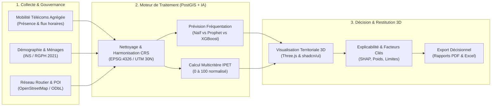
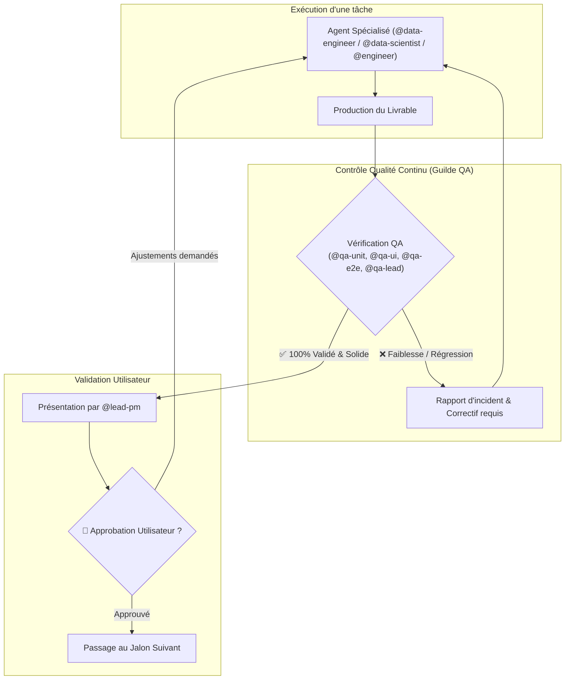

# Spécification Technique & Fonctionnelle : Orange EcoMobility Intelligence (OEMI)

**Projet** : Plateforme d'Intelligence Territoriale & Aide à la Décision (Orange Think Tank Challenge 2026)  
**Auteur** : Lead Project Manager & Architecte Système (@lead-pm)  
**Statut** : **En attente d'approbation explicite de l'Utilisateur**  
**Périmètre Pilote** : 3 communes du District Autonome d'Abidjan (Cocody, Yopougon, Marcory/Plateau)  
**Cas d'Usage** : Aide à l'étude d'implantation d'un supermarché  

---

## 🏛️ Règle Suprême de Gouvernance du Projet

> [!IMPORTANT]
> **Validation Utilisateur Obligatoire** : Le `@lead-pm` présente chaque jalon et choix structurant à l'Utilisateur. Aucune étape suivante n'est engagée sans son aval formel.
> **Vérification Continue à Chaque Étape** : Toute brique technique (ETL, modèle IA, composant 3D, endpoint API) subit un test immédiat par le pôle QA dédié. En cas de non-conformité, la tâche revient à l'agent responsable jusqu'à validation à 100%.

---

## 1. Contexte, Problématique & Proposition de Valeur

### 1.1 Problématique Centrale
> *Comment exploiter des données agrégées de mobilité, croisées avec des données géographiques, démographiques et économiques, afin d'anticiper les dynamiques territoriales et d'identifier des zones présentant un potentiel de développement pour l'implantation d'un supermarché en Côte d'Ivoire ?*

### 1.2 Chaîne de Valeur Unifiée (Mobilité + Économie Locale)
Contrairement aux simples cartes thermiques descriptives, OEMI apporte une **recommandation explicable** reposant sur un Indice de Potentiel Économique Territorial (**IPET**) calculé et visualisé en 3D immersive :

---

## 2. Architecture Technique Cible

### 2.1 Stack Technologique
- **Frontend & Restitution 3D** :
  - **Framework** : Next.js 15+ (App Router, React 19, TypeScript).
  - **Design System** : **shadcn/ui** (Radix UI, Tailwind CSS, Lucide icons, Dark/Light mode).
  - **Rendu Cartographique 3D** : **Three.js** (via React Three Fiber / Drei / Deck.gl) permettant :
    - Extrusion 3D des bâtiments et zones de chalandise d'Abidjan.
    - Colonnes et cônes 3D de densité de fréquentation en temps réel.
    - Visualisation spatiale des flux pendulaires et axes majeurs de transport.
- **Backend & Calculs Scientifiques** :
  - **Framework** : FastAPI (Python 3.11+, Pydantic v2).
  - **Base de Données** : PostgreSQL avec l'extension **PostGIS** pour les indexations spatiales (`GIST`) et requêtes géométriques (`ST_Within`, `ST_Distance`).
  - **Data Science & ML** : GeoPandas, Shapely, Scikit-learn (K-Means, silhouette), Prophet & XGBoost (séries temporelles).
  - **Génération de Rapports** : ReportLab (PDF) et OpenPyXL (Excel).

---

## 3. Modélisation Fonctionnelle & Moteur de Décision

### 3.1 Moteur IPET (Indice de Potentiel Économique Territorial)
L'IPET est calculé sur une échelle normalisée de **0 à 100** pour chaque zone $z$ et pour le secteur **Supermarché** ($s$) :

$$\text{IPET}(z, s) = \sum_{i=1}^{n} w_{i,s} \times X_{i,z,s}$$

#### Grille de Pondération Indicative du MVP :
| Critère ($X_i$) | Poids ($w_i$) | Règle de calcul & Justification |
| :--- | :---: | :--- |
| **Fréquentation agrégée** | **30 %** | Volume moyen de présence en journée et le week-end (cible courses). |
| **Bassin démographique** | **25 %** | Densité de population résidente issue du RGPH 2021 INS CI. |
| **Accessibilité & Réseau viaire** | **20 %** | Proximité des carrefours majeurs, fluidité et connectivité routière OSM. |
| **Dynamique / Croissance** | **15 %** | Tendance d'évolution de la fréquentation sur les semaines comparées. |
| **Contexte concurrentiel** | **10 %** | Éloignement des supermarchés existants (opportunité d'implantation). |

### 3.2 Explicabilité Intégrée
Chaque fiche de recommandation dans le dashboard affiche :
1. Les 3 facteurs contribuant le plus positivement au score (ex: *Excellente accessibilité routière + forte densité démographique*).
2. Les freins ou limites détectés (ex: *Présence d'un hypermarché concurrent à 300m*).
3. L'indice de complétude de la donnée et la mention de la date de calcul.

---

## 4. Cadre Juridique, Confidentialité & Stratégie de Repli

### 4.1 Conformité à la Loi Ivoirienne n° 2013-450
- **Principe du k-anonymat** : Tout agrégat géographique ou temporel comptant moins de $k$ personnes (seuil minimum fixé à 15 personnes) est automatiquement masqué.
- **Zéro PII** : Aucune donnée individuelle, numéro de téléphone, IMEI, IMSI ou traceur GPS brut n'est ingéré ou conservé.
- **Transparence** : Séparation stricte et étiquetage explicite entre données observées et données synthétiques.

### 4.2 Stratégie de Repli (Absence de données réelles Orange)
Conformément à la section 13.1 du CdC :
- En l'absence de transmission d'extraits réels Orange Flux Vision, un **générateur de mobilités synthétiques spatialement contraint** simule les déplacements pendulaires cohérents sur les communes de Cocody, Yopougon et Marcory.

---

## 5. Organisation des Rôles & Pôle QA avec Boucle de Vérification Continue

### Composition de la Guilde QA :
1. **`@qa-lead` (Privacy & Robustness Auditor)** : Garant de la conformité loi n° 2013-450, du k-anonymat et de l'étanchéité des données.
2. **`@qa-unit` (Unit & Algorithmic Tester)** : Tests des formules IPET, des transformations CRS et des scripts de nettoyage.
3. **`@qa-e2e` (E2E & Integration Tester)** : Tests de bout en bout (requête, calcul de score, génération de rapport PDF/Excel).
4. **`@qa-ui` (UI, 3D & WebGL Tester)** : Validation des performances du canvas Three.js (FPS, WebGL, réactivité) et des composants **shadcn/ui**.
