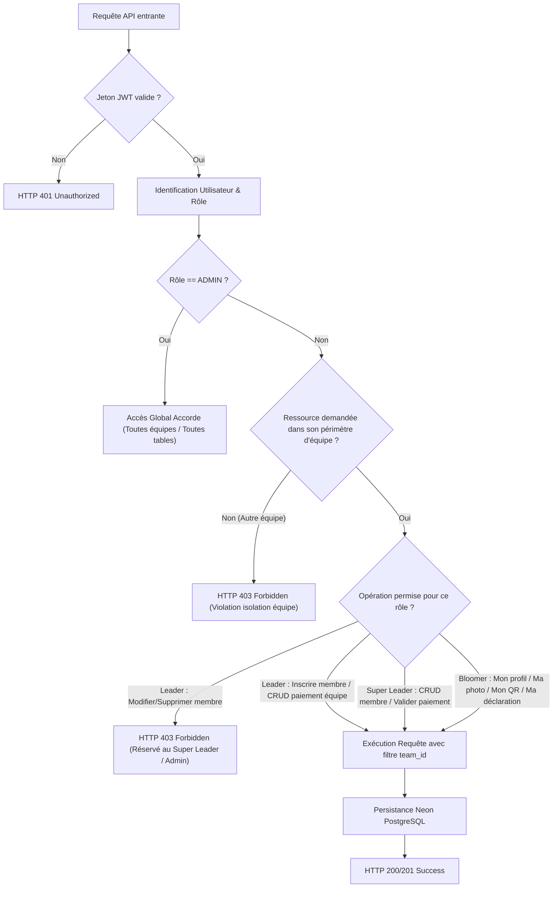
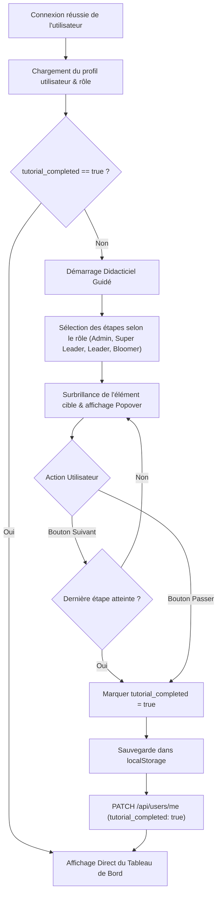

# Diagrammes d'Activité (UML Activity) - Christmas Party

Ce document modélise les flux décisionnels et les algorithmes métiers de l'application, conçu par **The System Designer & Modeler (@designer)**.

---

## 1. Flux d'Activité : Cycle de Contrôle d'Accès & Cloisonnement Multi-Tenant

---

## 2. Flux d'Activité : Parcours du Didacticiel Interactif Onboarding

