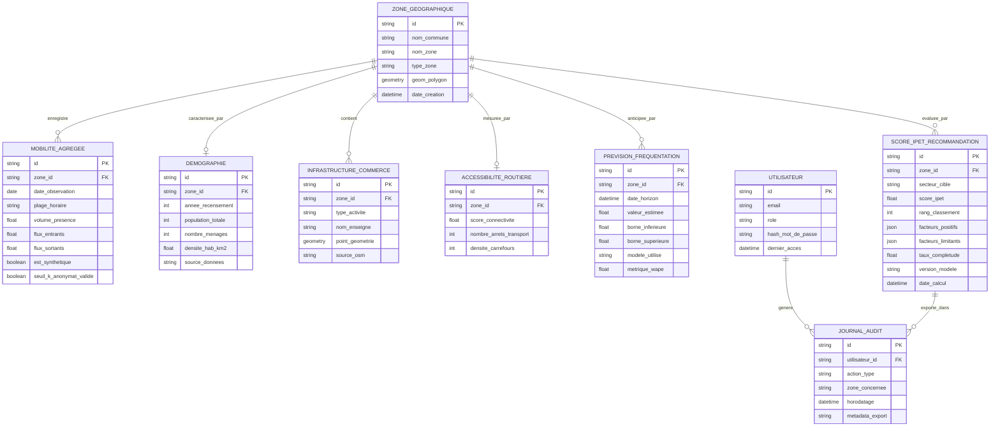

# Modèle Conceptuel de Données (MCD) - Orange EcoMobility Intelligence (OEMI)

Ce document formalise les entités, associations et cardinalités pour la plateforme d'intelligence territoriale OEMI.

---

## 1. Diagramme Entité-Relation (Merise / ERD)

