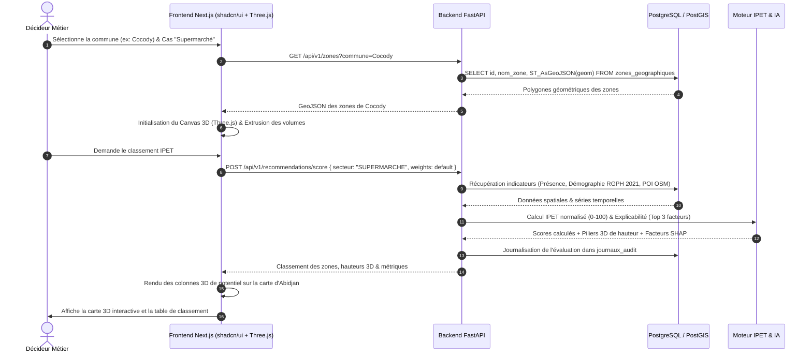
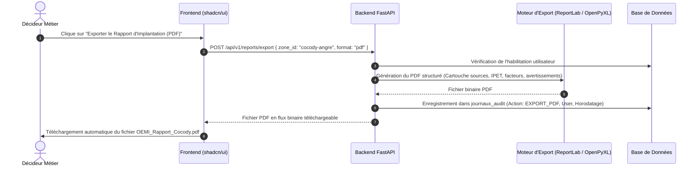

# Diagrammes de Séquences (UML Sequence) - OEMI

Ce document détaille la chronologie des flux d'échanges entre l'utilisateur, l'interface 3D (Next.js / Three.js / shadcn/ui), le backend FastAPI, la base PostGIS et les modèles d'IA.

---

## 1. Flux de Calcul et Visualisation 3D d'une Recommandation IPET

---

## 2. Flux de Téléchargement de Rapport Décisionnel (PDF/Excel)

