# Diagrammes de Cas d'Utilisation (UML Use Case) - OEMI

Ce document décrit les interactions des acteurs avec le système **Orange EcoMobility Intelligence (OEMI)**.

---

## 1. Acteurs du Système
1. **Administrateur** : Configuration générale, gestion des comptes utilisateurs, suivi des logs d'audit.
2. **Analyste SIG / Data Scientist** : Exploration des données brutes, ajustement des pondérations IPET, comparaison des modèles prédictifs et analyse de sensibilité.
3. **Utilisateur Métier (Décideur / Enseigne commerciale / Collectivité)** : Consultation des visualisations 3D, sélection des communes, filtrage temporel, consultation des classements IPET, analyse des facteurs explicatifs et export des rapports d'implantation.

---

## 2. Diagramme de Cas d'Utilisation Principal

```mermaid
graph TD
    A["👤 Utilisateur Métier (Décideur)"]
    B["👤 Analyste SIG / Data"]
    C["👑 Administrateur"]

    subgraph OEMI["Plateforme Orange EcoMobility Intelligence"]
        UC1["S'authentifier"]
        UC2["Visualiser la carte territoriale 3D (Three.js)"]
        UC3["Filtrer par commune, zone et plage horaire"]
        UC4["Consulter l'analyse de fréquentation et flux"]
        UC5["Consulter la prévision de fréquentation (IA)"]
        UC6["Générer le classement des zones selon l'IPET"]
        UC7["Consulter la fiche explicative (Facteurs positifs / freins)"]
        UC8["Exporter le rapport décisionnel (PDF / Excel)"]
        
        UC9["Ajuster les pondérations de l'IPET"]
        UC10["Comparer les modèles de prévision (Naïf vs Prophet vs XGBoost)"]
        UC11["Contrôler les seuils de k-anonymat"]
        
        UC12["Gérer les utilisateurs et habilitations"]
        UC13["Consulter le journal d'audit des exports"]
    end

    A --> UC1
    A --> UC2
    A --> UC3
    A --> UC4
    A --> UC5
    A --> UC6
    A --> UC7
    A --> UC8

    B --> UC1
    B --> UC3
    B --> UC9
    B --> UC10
    B --> UC11
    B --> UC8

    C --> UC1
    C --> UC12
    C --> UC13
```

